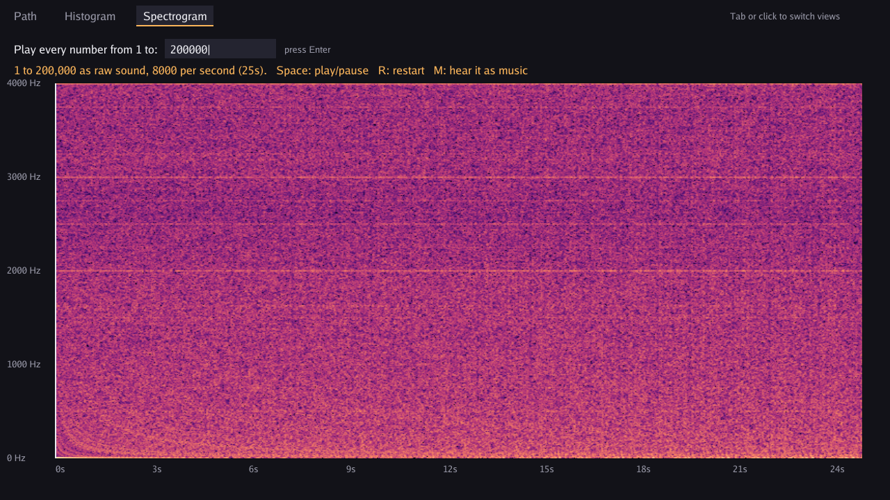

# Gollatz Conjecture

A Collatz conjecture visualizer in Go and [Ebitengine](https://ebitengine.org/). It graphs the path a number takes down to 1, counts how long every number takes, and then turns those numbers into music you can see and hear.


## The three views

### Path

Type a starting number and watch the path it takes down to 1. Short paths get an arrow and a label on every step. Long ones, like 27's 111 steps, get a plain line with the start and the peak marked.

Press Space to play the path as a melody. Each step is one note, and bigger numbers play higher, so you hear 27 climb up to 9,232 and fall back down to 1. The steps you've already heard turn orange as it plays.


### Histogram

Counts how many steps every number from 1 to N takes to reach 1, then shows how many numbers land on each step count. Hover over a bar to see its count.


### Spectrogram

Turns the step counts for 1 to N into music, one note per number, six notes a second. A number that takes more steps plays a higher note. The notes all come from the major pentatonic scale (C, D, E, G, A), which has no clashing notes, and a bass line underneath cycles through C, A minor, F, and G every eight notes.

The app then runs the music through an FFT (fast Fourier transform) to draw a spectrogram. Each short dash is one note, and the stepped bands at the bottom are the bass chords. Press Space to play or pause, and R to restart. A white line tracks where you are in the song.


Press M to switch to raw static. This feeds the step counts straight in as a sound wave, at 8,000 numbers per second, with no notes or scale. It mostly sounds and looks like static. The faint horizontal stripes suggest the sequence isn't completely random.



## The Collatz rules

Pick a whole number. If it's even, halve it. If it's odd, multiply by 3 and add 1. Repeat. The conjecture says you always reach 1. Nobody has proven it.

## Running it

1. Install Go 1.27 or newer from https://go.dev/dl/
2. Clone and run:

```
git clone https://github.com/saedarm/GollatzConjecture
cd GollatzConjecture
go run .
```

On Linux, Ebitengine needs a few system libraries first. See [Ebitengine's install guide](https://ebitengine.org/en/documents/install.html).

To build a Windows .exe without a console window:

```
go build -ldflags "-H=windowsgui" -o gollatz.exe .
```

## Controls

| Key | What it does |
| --- | --- |
| Tab, or click a tab | Switch views |
| Type digits, then Enter | Set the number for the current view |
| Space | Play or pause the melody (Path view) or the song (Spectrogram view) |
| R | Restart from the beginning |
| M | Switch between music and raw static (Spectrogram view) |

## How the music and spectrogram work

1. `StoppingTimes` in `collatz.go` works out the step count for every number from 1 to N. Each number walks only until it drops below where it started, then reuses the count already worked out for that smaller number.
2. `Melody` in `music.go` turns each number into a note. It spreads the numbers across three octaves of the pentatonic scale, smallest at the bottom and biggest at the top, and adds the bass line. For a single path it uses the number of digits rather than the raw size, so 27 and 9,232 don't end up squashed together.
3. `Render` plays those notes into audio samples. Melody notes get a quick strike and fade, like a marimba. Bass notes swell in and out.
4. `Spectrogram` in `spectrum.go` slides a 1,024-sample window along the audio, 256 samples at a time. It fades each chunk in and out with a Hann window and runs it through [gonum's FFT](https://pkg.go.dev/gonum.org/v1/gonum/dsp/fourier). Each chunk becomes one column of the picture.
5. `AudioBytes` packs the audio as 48 kHz stereo for Ebitengine's audio player.

In static mode, `Signal` skips steps 2 and 3 and feeds the step counts straight in as audio samples.

## Tests

```
go test ./...
```

## Files

- `main.go`: window, input, and drawing
- `collatz.go`: the Collatz math
- `music.go`: turning numbers into notes and notes into sound
- `spectrum.go`: FFT spectrogram and audio output
- `collatz_test.go`: tests
- `screenshots/`: the images in this README

## License

MIT. See [LICENSE](LICENSE).
