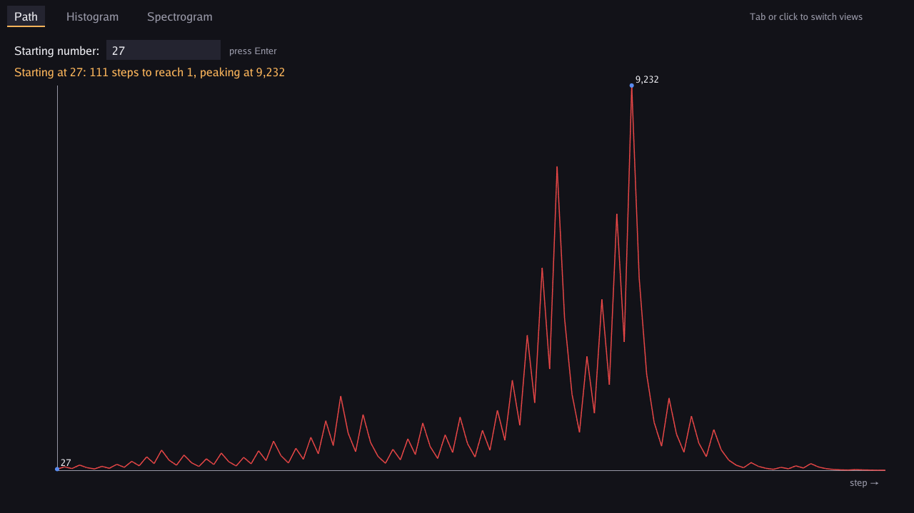
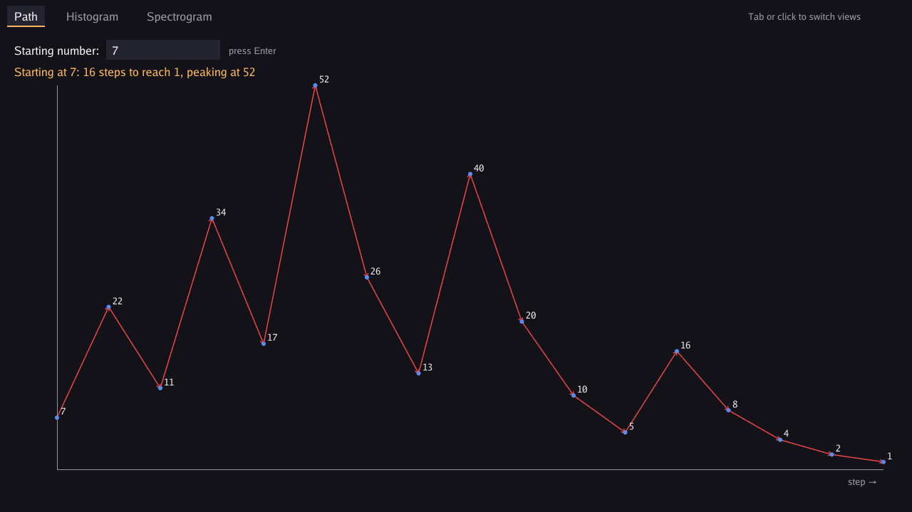
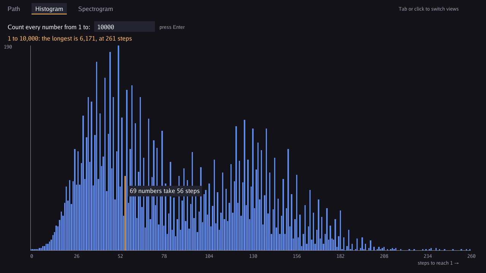
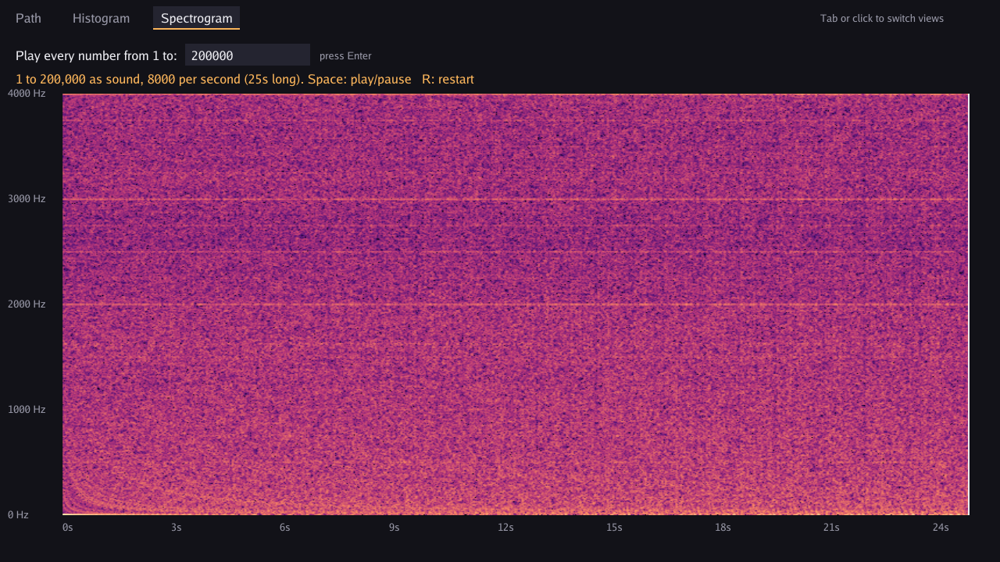

# Gollatz Conjecture

A Collatz conjecture visualizer in Go and [Ebitengine](https://ebitengine.org/). It graphs the path a number takes down to 1, counts how long every number takes, and then turns those counts into sound you can see and hear.



## The three views

### Path

Type a starting number and watch the path it takes down to 1. Short paths get an arrow and a label on every step. Long ones, like 27's 111 steps, get a plain line with the start and the peak marked.



### Histogram

Counts how many steps every number from 1 to N takes to reach 1, then shows how many numbers land on each step count. Hover over a bar to see its count.



### Spectrogram

Treats the step counts for 1 to N as a sound wave, at 8,000 numbers per second. It runs that wave through an FFT (fast Fourier transform) to draw a spectrogram, and lets you listen to it. Press Space to play or pause, and R to restart. A white line tracks where you are in the sound.



## The Collatz rules

Pick a whole number. If it's even, halve it. If it's odd, multiply by 3 and add 1. Repeat. The conjecture says you always reach 1. Nobody has proven it.

## Running it

1. Install Go 1.25 or newer from https://go.dev/dl/
2. Clone and run:

```
git clone https://github.com/saedarm/GollatzConjecture
cd GollatzConjecture
go run .
```

On Linux, Ebitengine needs a few system libraries first. See [Ebitengine's install guide](https://ebitengine.org/en/documents/install.html).

To build a Windows .exe without a console window:

```
go build -ldflags "-H=windowsgui" -o gollatz.exe .
```

## Controls

| Key | What it does |
| --- | --- |
| Tab, or click a tab | Switch views |
| Type digits, then Enter | Set the number for the current view |
| Space | Play or pause the sound (Spectrogram view) |
| R | Restart the sound (Spectrogram view) |

## How the spectrogram works

1. `StoppingTimes` in `collatz.go` works out the step count for every number from 1 to N. Each number walks only until it drops below where it started, then reuses the count already worked out for that smaller number.
2. `Signal` in `spectrum.go` centers those counts on zero and scales them to the -1 to 1 range, so they can be treated as audio samples.
3. `Spectrogram` slides a 1,024-sample window along the signal, 256 samples at a time. It fades each chunk in and out with a Hann window and runs it through [gonum's FFT](https://pkg.go.dev/gonum.org/v1/gonum/dsp/fourier). Each chunk becomes one column of the picture.
4. `AudioBytes` turns the same signal into 48 kHz stereo audio for Ebitengine's audio player.

It mostly looks like static. The faint horizontal stripes suggest the sequence isn't completely random.

## Tests

```
go test ./...
```

## Files

- `main.go`: window, input, and drawing
- `collatz.go`: the Collatz math
- `spectrum.go`: FFT spectrogram and audio
- `collatz_test.go`: tests
- `screenshots/`: the images in this README

## License

MIT. See [LICENSE](LICENSE).
